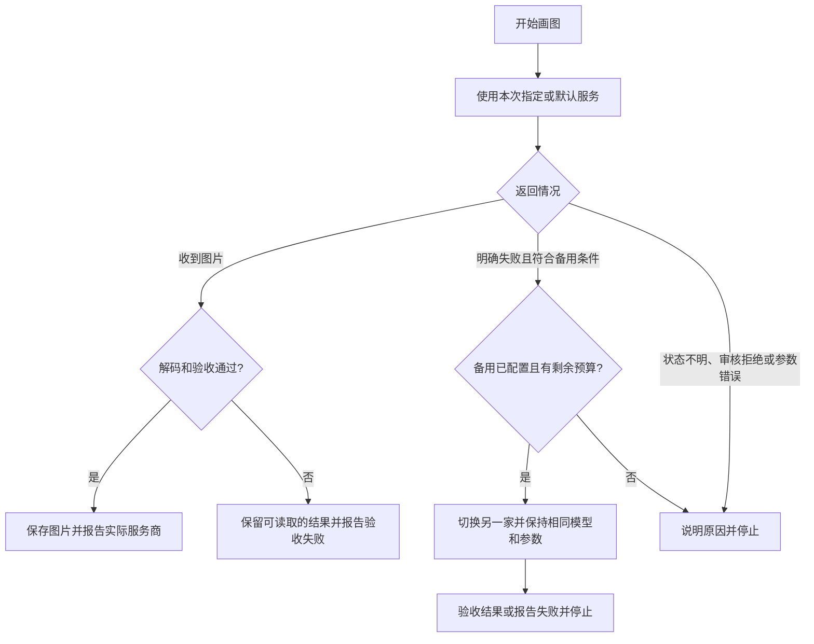

# GPT画图：安装、使用与故障处理

中文名 **GPT画图**，英文标识 **gpthuatu**，在 AI 工具中通过 `$gpthuatu` 调用。默认模型为 `gpt-image-2.5-flare`，需要所选服务商的账号支持该模型。

## 1. 安装

使用支持本地 Skill 的 AI 工具，例如 Codex 或 Claude Code。需要 Node.js 22.19 或以上，推荐 24 LTS；无需 Python，也不需要安装运行依赖。

把下面的话发给 AI 即可：

> 请安装 https://github.com/metafeng/gpthuatu 的 GPT画图 Skill，保留我的已有配置，安装后检查是否能识别技能。

默认安装到 `~/.agents/skills/gpthuatu`，并为 Codex、Claude Code 建立入口。安装后重新打开 AI 工具或刷新技能列表。

直接安装 gpthuatu 即可，无需处理其他技能。重复安装 gpthuatu 时会保留目标安装目录里已有的私有配置；安装来源目录中的私人 .env 不会被带入。自定义安装位置以实际路径为准。

## 2. 获取并保存 Key

新用户可以直接说“帮我配置放心 API 的 Key”或“帮我配置 TTAPI 的 Key”，由 AI 帮助保存。

| 服务商 | 获取 Key | 本机保存名称 | 自动对应接口与认证 |
|---|---|---|---|
| 放心 API | [点击获取](https://fangxinapi.com/keys)，选择支持所选画图模型的画图分组 | `FANGXIN_API_KEY` | `https://fangxinapi.com/v1`，Bearer |
| TTAPI | [点击获取](https://dashboard.ttapi.io)，确认支持所选模型 | `TT_API_KEY` | `https://api.ttapi.io/v1`，TT-API-KEY |
| OpenAI 官方 | [点击获取](https://platform.openai.com/api-keys)，确认模型权限 | `OPENAI_API_KEY` | `https://api.openai.com/v1`，Bearer |

只有一串 Key 且没有明确来源时，AI 先问属于哪家，得到回答后再保存，不根据 Key 的外观猜测，也不向多家接口试投。已经说明来源或给出对应接口链接时，直接保存，不反复询问。

默认保存在安装目录的私有 `.env` 文件，配置文件自定义时使用指定文件。AI 增量更新对应变量，保留其他服务商 Key、模型、代理等配置，不覆盖整个文件，不回显密钥。只填一家 Key 时使用这一家；两家都填时放心首选、TT 备用。模型统一由 IMAGE_MODEL 配置，不另填服务商选择项。

Key 不进入源码、公开文档、GitHub 或生成结果。macOS/Linux 私有配置文件权限为 600，Windows 使用当前用户权限。

其他服务商需要提供接口地址、Key 和认证方式，按 `custom` 配置。只支持同步返回图片内容或图片链接的 OpenAI 兼容接口；异步任务编号或其他协议需要另外适配。不能凭“有链接、有 Key”保证任意接口都能用。

## 3. 检查是否配置好

对 AI 说“检查 GPT画图配置，不要提交出图请求”。检查会显示首选服务、接口、模型、Key 变量名称、密钥数量和备用服务，不显示 Key。

这一步只确认配置能读入，不证明 Key 有效、账号有余额、模型有权限或服务当前可用。真实出图只有在用户提出画图或测试要求后才提交。

如果配置不生效，还要检查是否有同名环境变量覆盖了文件；进程环境变量优先于文件。不要为了修复文件而删除另一家已保存的 Key。

## 4. 平时怎么用

选择「GPT画图」或输入 `$gpthuatu`，直接描述内容、风格、比例。改图时附上原图；多图合成时提供多张参考图；局部修改可以提供遮罩。

| 你怎么说 | 程序怎么处理 |
|---|---|
| 帮我画一张图 | 先使用已保存的默认服务商 |
| 用 TT 画这张图 | 本次先用 TT，符合条件时以放心备用 |
| 用放心画这张图 | 本次先用放心，符合条件时以 TT 备用 |
| 这次只用 TT，不要备用 | 本次使用 TT，并关闭自动备用 |
| 本次用其他支持的模型 | 本次 --model 覆盖 IMAGE_MODEL，不改文件 |

未配置通用接口地址时，程序按已填写 Key 的固定顺序选择首选：放心 → TT → OpenAI。只保存一家时就使用这一家；本次明确指定的服务优先。配置了通用接口地址时使用对应的配对配置；通用 Key 不能脱离地址单独使用。明确指定的首选服务缺少 Key 时，先补配置，不擅自更换。

模型选择顺序为：本次指定模型 → IMAGE_MODEL → `gpt-image-2.5-flare`。服务商切换时保持本次模型、提示词和画图参数一致。

提交前检查提示词、尺寸、数量、参考图、遮罩和输出目录。能在本机发现的问题先修复，再提交收费请求。

## 5. 双向备用什么时候触发

**只有明确失败或确认尚未提交时才切换；不能确认是否已经出图或扣费时，先停止。**

放心与 TT 的 Key 都正确配置时，默认互为备用；只配置一家时就只用这一家。OpenAI 官方和 `custom` 不自动加入这对备用服务。

默认整项任务最多提交 3 次出图请求，两家的所有 Key 共用；首选服务最多先尝试 2 次，至少留 1 次给备用。账号明确拒绝、限流要求等待很久时可以提前切换。整个任务共用 600 秒总网络预算，单次请求默认上限为 420 秒。

一次任务最多切换一次，两家按顺序尝试，不同时提交，不来回循环，不自动改变下次的默认服务。切换时整体使用另一家的地址、认证和 Key，编辑上传按该家的协议重建，不把放心的 Key 发给 TT，也不把 TT 的 Key 发给放心。

正常等待、长时间没收到图片、笼统“服务异常”提示都不能单独触发切换。“任务失败或需要审核”属于混合提示，不能擅自认定为普通故障。

用户要求本次只用一家时使用 `--no-fallback`；长期关闭可设置 `IMAGE_API_FALLBACK=off`，恢复为 `auto`。请求次数设为 1 时也不会切换。

## 6. 出错后如何处理

| 情况 | 自动处理 | 接下来怎么解决 |
|---|---|---|
| 未配置 Key、来源不明、默认服务不明确 | 停止出图，提示补充或选择 | 说明服务商，由 AI 保存对应 Key、检查首选与备用 |
| 401，Key 被拒绝 | 先尝试同一家已配置的其他 Key；符合预算时转备用 | 检查 Key 是否填写正确、是否撤销或过期 |
| 402，账号拒绝 | 符合条件时转备用 | 查看控制台余额、额度或响应中的具体原因 |
| 404，接口或资源不存在 | 符合条件时转备用 | 核对接口地址、模型名和账号权限，不自动换模型 |
| 429，限流 | 遵守同一家重试等待；持续失败时转备用，等待超过 30 秒可提前转备用 | 降低并发，检查服务商限额 |
| 连接失败且确定请求未提交 | 预算内重试，仍失败时可转备用 | 检查网络和代理；各家 Key 分别保留 |
| 4xx 携带明确任务失败代码且无审核信息 | 符合条件时转备用 | 保留请求编号，检查原服务商任务记录 |
| 400/422 普通参数错误 | 停止，不靠换服务商解决 | 按错误修正尺寸、模型参数或参考图 |
| 403、审核拒绝、失败与审核混合提示 | 停止，不自动切换 | 按提示检查权限或内容，不通过备用绕过限制 |
| 提交后超时、中断，或 5xx | 默认停止，不跨服务重发 | 先查原服务商是否已出图或扣费，再决定新操作 |
| 接口称成功，但响应异常或图片下载失败 | 停止，不重新生成 | 检查原任务和返回结果，可能已经生成或扣费 |
| 图片无法解码、数量/格式/透明度不符 | 验收失败，保留能读取的图片 | 查看结果记录，处理已有结果后再决定是否新生成 |
| 实际尺寸与要求不同 | 默认保留图片并提醒；严格尺寸模式返回验收失败 | 检查实际尺寸，按需求决定后续处理 |
| 备用配置损坏 | 首选仍可用时继续使用首选并提醒 | 检查对应服务商的配置，修复后再启用备用 |
| 两家都失败或预算用尽 | 报告并停止 | 查看两家的请求记录，修复原因后再发起新任务 |
| 用户取消 | 停止后续请求 | 已提交任务可能仍在服务器处理，必要时查控制台 |

允许跨服务切换的明确任务失败代码为 `task_failed`、`upstream_task_failed`、`image_generation_failed`，且必须是 4xx、不包含审核拒绝。其他未识别错误默认停止，不泛化为可切换故障。

服务商返回的 HTTP 状态、错误消息和请求编号来自接口；`PROVIDER_ERROR`、重试次数、配置或验收错误分类由技能生成。不能仅凭“上游异常”提示判定具体是哪一层服务出了问题。

## 7. 什么才算出图成功

收到 HTTP 200 不等于完成。程序会完整解码图片，核对实际格式、尺寸、数量和透明区域，再保存本地图片及结果记录。

成功后展示图片，给出绝对文件路径，并说明实际模型、服务商、耗时和提醒。发生备用切换时，结果记录包含首选服务、最终服务、切换原因和各次请求的服务商。

支持 PNG/JPEG。服务商忽略 JPEG 格式参数时可以本地转码，并保留原图。局部编辑通过遮罩合成尽量保留未选中区域；JPEG 仍存在有损压缩。WebP 暂未开放，Flare 透明背景默认不提交，须明确接受试验性质后再试。

## 8. 查看当前配置与验证情况

对 AI 说“查看 GPT画图当前首选和备用服务商，不要提交出图请求”。以本机实际检查结果为准，不根据安装示例或其他人的默认设置推断。

双向备用及停止边界已通过模拟测试，整个项目 43 项测试与 Windows/macOS/Linux × Node 22/24 检查通过。TT 文生图曾真实出图成功；未进行两家收费故障切换演练，TT 编辑等未实测能力以 [兼容性记录](compatibility.md) 为准。历史成功不保证服务商一直可用。
